<!--
  Profile README for github.com/aaatishphadte
  Every graphic here is drawn by scripts/build.py (edit CONFIG at the top, then run it).
  No Actions? Run `python scripts/build.py --live` on your computer (no token needed) and push /assets.
  .github/workflows/profile.yml does the same thing daily once Actions is available on the account.
-->

<a href="https://github.com/aaatishphadte"></a>

 

I'm a technical founder from <b>Goa, Bharat</b>, building two companies: 
<b>DataTree Studios</b>, a game studio, and <b>BooleanChitra</b>, an AI software agency. 
Right now I'm deep in <b>Gen-AI</b>, <b>MCP</b> and <b>AI agents that automate real work</b>, and I'm building it all in public.

 

<picture>
  <source media="(prefers-color-scheme: dark)" srcset="https://raw.githubusercontent.com/aaatishphadte/aaatishphadte/main/assets/head-ventures-dark.svg">
  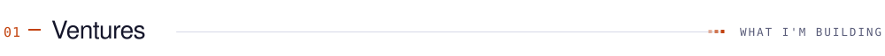
</picture>

  
  <a href="https://booleanchitra.dattatrayfadte.workers.dev/">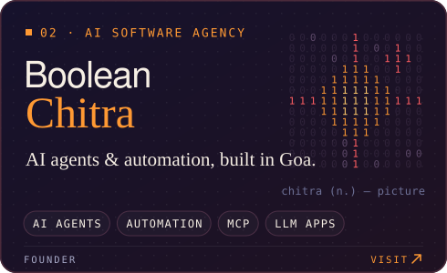</a>

 

<picture>
  <source media="(prefers-color-scheme: dark)" srcset="https://raw.githubusercontent.com/aaatishphadte/aaatishphadte/main/assets/head-work-dark.svg">
  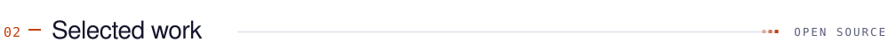
</picture>

  <a href="https://github.com/aaatishphadte/Gen-AI-RPG-Game">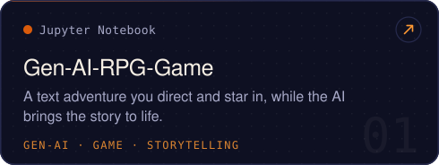</a>
  <a href="https://github.com/aaatishphadte/ai-pdf-chatbot-langchain">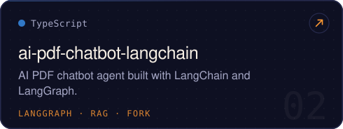</a>
  <a href="https://github.com/aaatishphadte/Ecommerce-Product-Scrapper">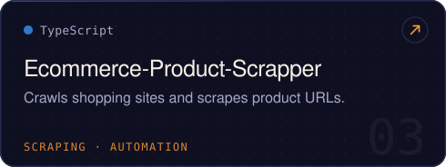</a>
  <a href="https://github.com/aaatishphadte/ecommerce-crawler">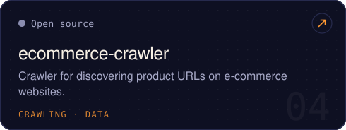</a>

 

<picture>
  <source media="(prefers-color-scheme: dark)" srcset="https://raw.githubusercontent.com/aaatishphadte/aaatishphadte/main/assets/head-toolkit-dark.svg">
  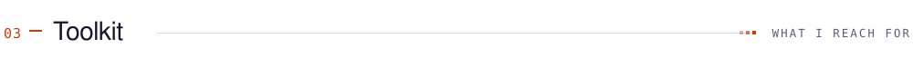
</picture>

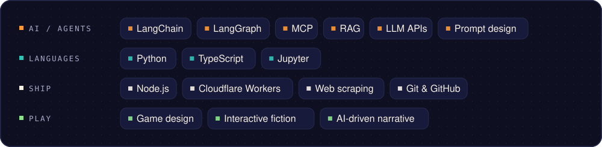

  

<picture>
  <source media="(prefers-color-scheme: dark)" srcset="https://raw.githubusercontent.com/aaatishphadte/aaatishphadte/main/assets/head-momentum-dark.svg">
  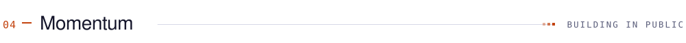
</picture>

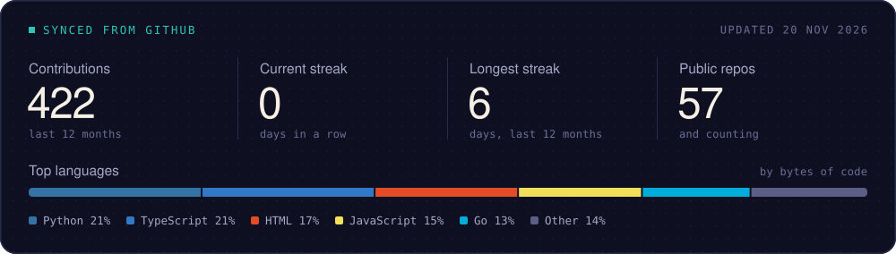

 


  

